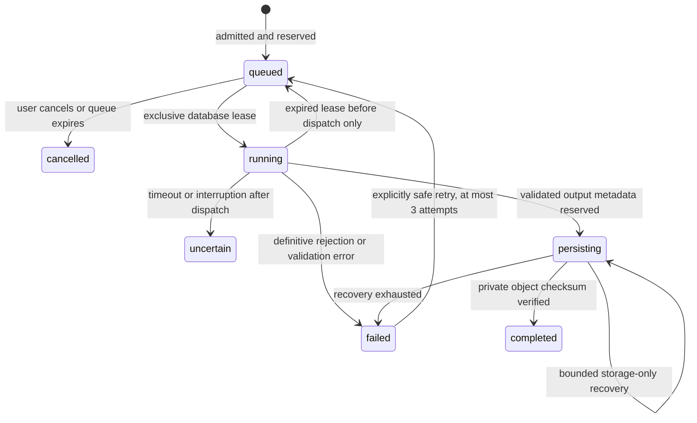

# Phase 2 — reference-image processing

Status on 28 October 2026: implemented locally; **not verified against real OpenAI and not ready to close Phase 2**. The production `main` branch must retain the verified Phase 1 release until activation prerequisites are satisfied.

## What was implemented

The matching Undici fetch, proxy dispatcher, and multipart FormData implementation are used together; a real local proxy test verifies binary form encoding and deadlines. The existing Express/TypeScript service, Supabase verified identities and RLS, `images`, `processing_jobs`, `usage_events`, and private `photos` bucket are reused. No competing service, public bucket, client-side provider key, image packs, Brand Studio, bulk jobs, subscription, or payment system was added.

Authenticated users can select an uploaded reference, choose personal enhancement, professional portrait, or product enhancement, configure quality and a supported canvas, supply up to 1,500 characters of instructions, and submit an edit. Mode-specific preservation instructions and explicit provider consent are required. The backend sends the reference bytes to OpenAI's real `/v1/images/edits` endpoint. There are no production mocks or simulated results.

The result screen polls durable job state, displays the reference and completed output, exposes the existing authenticated download endpoint, and permits revisiting results through project history. Missing credentials or migration disable generation with a clear message; stored photographs remain available.

## API research and limitations

Official sources retrieved successfully through the allowed GitHub route:

- [OpenAI Node SDK image resource](https://github.com/openai/openai-node/blob/master/src/resources/images.ts).
- [OpenAI OpenAPI specification](https://github.com/openai/openai-openapi/blob/master/openapi.yaml).

These sources currently document reference-image edits, PNG/JPEG/WebP inputs below 50 MB per image, base64 results for GPT Image models, WebP output/compression controls, and low/medium/high quality. They list newer 2.5 models and indicate that the old `gpt-image-1` has been shut down. They document `input_fidelity=high` for `gpt-image-1.5`; this parameter is omitted for the newer models. The service deliberately retains the stricter existing application upload limits.

The configured candidate is the pinned `gpt-image-2.5-flare-2026-09-08`. The pinned sunburst snapshot and `gpt-image-1.5` are also allowlisted server-side. This is **not a verified claim that flare has the lowest cost or best quality**: the current [image guide](https://developers.openai.com/api/docs/guides/image-generation), [model documentation](https://developers.openai.com/api/docs/models), and [pricing page](https://openai.com/api/pricing/) were blocked by this environment's proxy. Primary pricing/model-comparison review remains an activation blocker. No numeric production prices were invented.

For predictable limits the initial implementation requests one image at `1024x1024`, `1536x1024`, or `1024x1536`; it does not advertise experimental/custom/native 4K output. High is the default maximum quality, configurable downward. Closest-match framing selects a supported canvas; the prompt requests subject preservation and restrained background extension rather than distortion. This does not guarantee exact aspect ratio preservation or recovery of lost detail. Higher quality/resolution offerings need separate cost and capability validation before inclusion.

Downloaded source snapshots used during development:

- SDK resource SHA-256: `6780bc97fe28f7c3cab0c54464d11f94b8cfe2028ea2388de3fcb30df4a2ffea`.
- OpenAPI SHA-256: `8614030ebfae4be271568ce5df9ddc89efdec8b91d8e7117c0aed83b12845e48`.

## Persistence and recovery

Only the additive `supabase/migrations/202610280001_processing.sql` is new. **Do not rerun the Phase 1 migration.** `supabase/checks/phase-2-preflight.sql` is the existing-project read-only review entry point for this change. The new migration has passed local PostgreSQL execution tests; it has not been applied to the hosted project. The application service-role key cannot execute arbitrary SQL migrations.

The migration extends the reserved jobs and usage tables, preserves all existing rows and RLS policies, adds worker RPCs restricted to `service_role`, and updates the existing image-quota trigger to reserve output capacity. Image/project deletion nulls completed history references while preserving job/usage accounting. Active sources/results cannot be deleted mid-job. Originals remain Phase 1's validated, metadata-stripped normalized WebP references; byte-for-byte archival of the incoming JPEG/PNG is not promised.

A database submission key plus request fingerprint deduplicates submissions, including a lost browser response. Cross-process leases and an atomic dispatch marker fence duplicate workers. An unknown provider outcome is never automatically regenerated. HTTP 401/403 and 429 rejection can be explicitly retried, within limits; provider timeouts/5xx remain uncertain. This is not a claim of exactly-once billing across a remote synchronous API.

Provider usage is checkpointed before output validation/storage. Valid decoded WebP output must match the requested dimensions, is re-encoded without metadata or upscaling, and is uploaded to the deterministic owner-scoped result key. Publication requires a checksum-verified storage readback and an atomic database completion. Storage acknowledgements/checkpoints can be retried without repeating the edit. Interrupted persisting jobs get up to five bounded recovery passes; exhausted jobs fail honestly. A provider result lost before it can be durably stored cannot be reconstructed without another billable request.

The worker runs inside the existing long-lived Node process, polls every 2.5 seconds, and can resume queued work after restart. Hostinger must keep the Node process running; scale-to-zero pauses work until a process starts again. Browser requests return promptly rather than waiting for a multi-minute generation. Request timeouts are configurable (30–600 seconds), with heartbeat leases and shutdown abort handling. Current default global concurrency is one.

Existing maintenance removes old pending/deleting image objects after 24 hours. It does not delete ready outputs or the retained processing ledger. Provider-side image retention/deletion follows the selected OpenAI project's actual policy and must be included in the owner's published disclosures.

## Cost controls

`AI_PROCESSING_ENABLED=1` is required. An absent key, absent/invalid budget, or absent/invalid price configuration keeps generation disabled. All settings are listed in `.env.example`. Text-output pricing may be omitted when not published/applicable; if the provider reports text output without its configured rate, the cost estimate remains unknown.

- One output per operation; allowlisted model, quality, canvas, input size and instruction length.
- Database-serialized per-user active-job limit, per-user/global daily request limits, and per-user/global daily budget reservations. UTC defines the reset day.
- Output image count/bytes are reserved before dispatch, so ordinary uploads cannot consume an active job's result slot.
- A conservative `AI_OPERATION_RESERVE_USD` is charged against admission budgets even if billing is unknown. A larger available token-cost estimate consumes the larger amount for subsequent admission checks. Reservations are not released by cancelling/deleting images; users cannot delete the spend ledger through the application.
- Usage token counts, provider request ID, model, immutable configured price snapshot, cost basis and estimated micro-USD cost are recorded per job. Cost is null, never a fabricated zero, if required provider token breakdowns or reliable rate information are absent. Cached tokens use uncached configured rates for the estimate. Provider invoices are authoritative.

These are application **reservation and operation-count safeguards, not a guaranteed provider invoice ceiling**. No supported image API request parameter supplies a hard per-call dollar ceiling. Conservative reservations and the OpenAI project's available billing/usage controls must be reviewed together; already admitted/in-flight work can incur charges beyond an inaccurate reservation. There are no customer charges, credits, subscriptions, or purchases in this phase.

## Activation requirements

1. Complete current official model/pricing review and set the model-specific rates/version and reservation budgets in server environment configuration. Do not copy the deliberately fictitious rates from tests.
2. Add the real key securely as `AI_OPENAI_API_KEY`. It needs a funded OpenAI API project and access to the selected image-edit model; additional organization verification may be required. Never enter it in the browser bundle, Git, logs or chat.
3. Review the read-only preflight, back up the intended database, apply only the new Phase 2 migration once, then rerun the read-only check. Existing Supabase bindings must be retained.
4. Enable processing and restart the Node service with these settings. No service key or OpenAI key is sent to the browser. The cloud environment and Hostinger have separate environment configuration; a cloud key binding does not configure Hostinger automatically.
5. Execute the genuine, explicitly billable integration test against designated development Supabase/OpenAI projects, then verify the deployed authenticated workflow before production promotion. Existing production mail/callback configuration must work for customer sign-up; this change does not replace it.

A cloud draft has been saved with `api.openai.com`, `developers.openai.com`, `openai.com`, and the existing Hostinger hostname added alongside the existing Supabase host. It declares `SONKOFLOW_OPENAI_API_KEY` delivered as `AI_OPENAI_API_KEY`; the platform reserves `OPENAI_` variable names. Saving the draft does not apply it: review, secure key entry, save and publish are still required.

## Commands and evidence

- `npm run build`: Vite + TypeScript production compilation.
- `npm run test:unit`: backend/security/transport, real local PostgreSQL migration/RLS/state transitions/limits, provider adapter contracts, output decoding, storage failures and recovery, and usage accounting. Only tests inject fake providers/stores; PostgreSQL/Sharp perform real validation.
- `npm test`: marketing regression checks at desktop/tablet/mobile sizes.
- `npm run test:browser`: account/workspace/editor/result/history presentation with explicitly mocked API fixtures, including lost-response resubmission. These do not prove live authentication or generation.
- `npm run check:processing`: read-only configuration/schema/model-access check. It never generates an image.
- `RUN_LIVE_PROCESSING=1 npm run test:live:processing`: real, billable integration test for three modes, duplicate protection, cross-tenant denial, private output download and saved history. Isolated development test accounts are cleaned up when terminal; active interrupted jobs are retained and identified for reconciliation.

Observed hosted readiness: the version RPC returned **HTTP 404 / PGRST202**, so the new migration is not verified on the real project. The OpenAI key is absent, processing is disabled, and OpenAI destinations/pricing pages remain blocked by the currently enforced network policy. The genuine live test was skipped; no real OpenAI result has been received by this application during this task. Local passing tests must not be presented as completion of the Phase 2 real-service criterion.

## Local verification result

The production build and TypeScript compilation passed. All 42 backend/database/provider tests, 15 landing-page browser checks, and 24 account/workspace/processing browser checks passed after corrections (81 distinct local checks). The processing browser checks use test fixtures. A test-fixture response-disposal race was fixed by serving preloaded local image bytes.

An additional real HTTP proxy transport check caught and fixed a multipart branding mismatch: matching Undici FormData now emits an actual binary multipart upload rather than `text/plain`. Multipart encoding and abort deadlines passed on both the workspace Node runtime and Node 22.12.0. A Node 22.12.0 root-entry smoke check passed health, marketing content, and unauthenticated job denial (HTTP 401).

The genuine three-mode OpenAI integration test was **skipped**, not passed. The hosted migration check remains HTTP 404/PGRST202. No hosted migration was applied and no real provider image was generated by this application. Code is prepared for review on `phase-2/core-processing`; promotion to the production `main` branch remains pending the real-service gates above.
